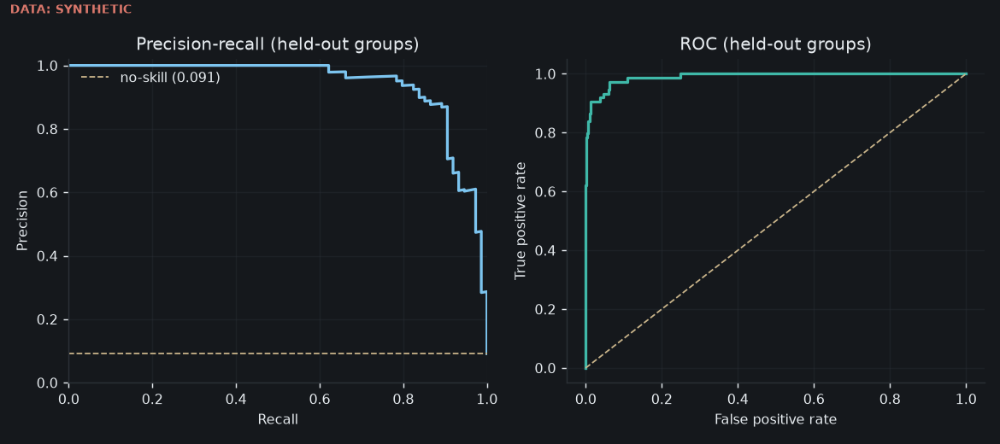
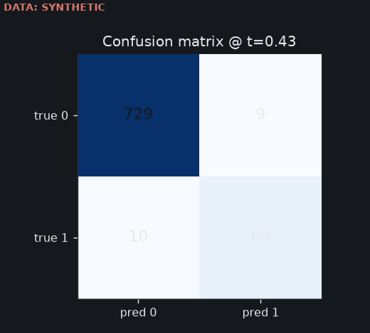
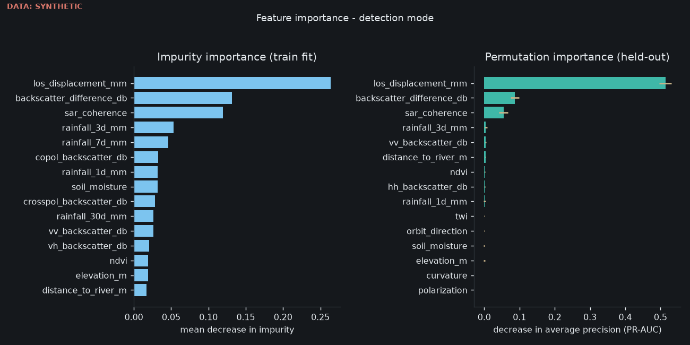
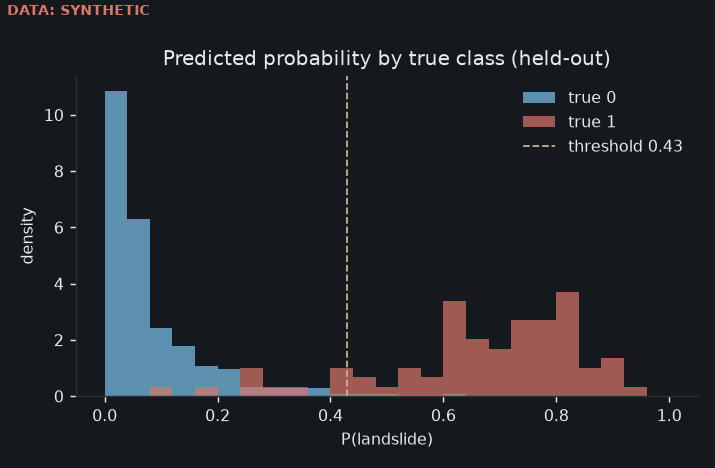
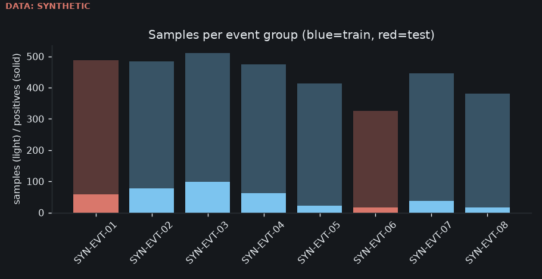

# TerraPulse training report - detection mode

> **WARNING - SYNTHETIC DATA.** These numbers describe a model trained on fabricated data. They validate the software pipeline only and say nothing about the 2024 Thame GLOF.

**Mode:** RETROSPECTIVE DETECTION: identifies where a landslide/flood change already occurred, using post-event SAR change measurements plus terrain/environmental context. It is NOT a forecast.

- Data: `terrapulse_synthetic_v1.csv` (provenance: SYNTHETIC)
- Trained: 2026-11-14T06:56:54+00:00
- Split: pre-assigned train_test_group - train groups ['SYN-EVT-02', 'SYN-EVT-03', 'SYN-EVT-04', 'SYN-EVT-05', 'SYN-EVT-07', 'SYN-EVT-08'], test groups ['SYN-EVT-01', 'SYN-EVT-06']
- n_train=2707 (pos rate 0.116), n_test=812 (pos rate 0.091)
- Decision threshold: 0.430 (out-of-fold training predictions (max F1))

## Held-out test groups

| metric | @0.5 | @tuned | no-skill |
|---|---|---|---|
| precision | 0.925 | 0.877 | |
| recall | 0.838 | 0.865 | |
| F1 | 0.879 | 0.871 | |
| PR-AUC | 0.943 | | 0.091 |
| ROC-AUC | 0.990 | | 0.500 |
| Brier | 0.028 | | |

Confusion matrix @tuned: TN=729 FP=9 FN=10 TP=64

## Grouped CV on training groups (mean +/- std, threshold 0.5)

| metric | mean | std |
|---|---|---|
| precision | 0.963 | 0.025 |
| recall | 0.723 | 0.099 |
| f1 | 0.822 | 0.069 |
| pr_auc | 0.914 | 0.030 |
| roc_auc | 0.979 | 0.008 |

## Top features (impurity)

1. `los_displacement_mm` - 0.2636
2. `backscatter_difference_db` - 0.1318
3. `sar_coherence` - 0.1197
4. `rainfall_3d_mm` - 0.0535
5. `rainfall_7d_mm` - 0.0460
6. `copol_backscatter_db` - 0.0325
7. `rainfall_1d_mm` - 0.0322
8. `soil_moisture` - 0.0316
9. `crosspol_backscatter_db` - 0.0286
10. `rainfall_30d_mm` - 0.0262
11. `vv_backscatter_db` - 0.0261
12. `vh_backscatter_db` - 0.0203

## Top features (permutation, held-out PR-AUC drop)

1. `los_displacement_mm` - 0.5138 +/- 0.0169
2. `backscatter_difference_db` - 0.0869 +/- 0.0120
3. `sar_coherence` - 0.0545 +/- 0.0122
4. `rainfall_3d_mm` - 0.0048 +/- 0.0033
5. `vv_backscatter_db` - 0.0037 +/- 0.0014
6. `distance_to_river_m` - 0.0035 +/- 0.0007
7. `ndvi` - 0.0013 +/- 0.0008
8. `hh_backscatter_db` - 0.0012 +/- 0.0006
9. `rainfall_1d_mm` - 0.0011 +/- 0.0025
10. `twi` - 0.0002 +/- 0.0012
11. `orbit_direction` - 0.0002 +/- 0.0003
12. `soil_moisture` - 0.0002 +/- 0.0015

## Features

- numeric: vv_backscatter_db, vh_backscatter_db, hh_backscatter_db, hv_backscatter_db, sar_coherence, backscatter_difference_db, incidence_angle_deg, los_displacement_mm, elevation_m, slope_deg, aspect_deg, curvature, twi, distance_to_river_m, distance_to_road_m, rainfall_1d_mm, rainfall_3d_mm, rainfall_7d_mm, rainfall_30d_mm, soil_moisture, ndvi, copol_backscatter_db, crosspol_backscatter_db, cross_co_ratio_db
- categorical: orbit_direction, polarization, land_cover, geology
- excluded by leakage rules: acquisition_date, landslide_label, landslide_severity, landslide_area_m2, landslide_displacement_m, change_classification, sample_id, event_id, latitude, longitude, event_date, satellite_mission, product_type, inventory_source, label_confidence, data_quality_flag, train_test_group

## Plots

