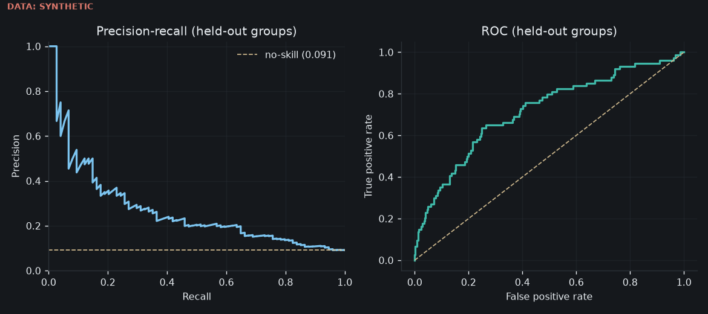
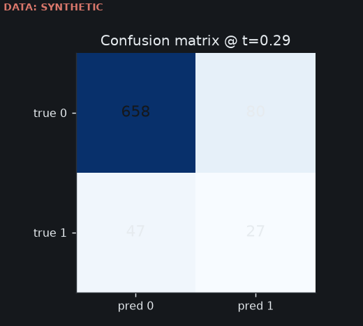
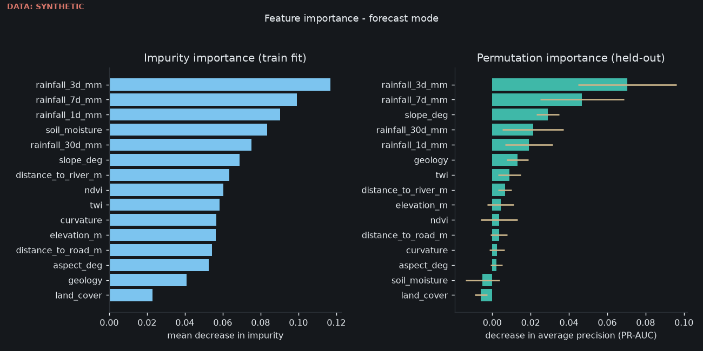
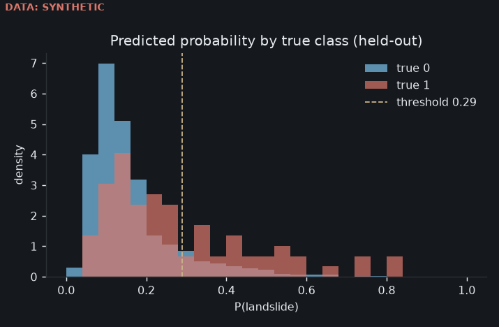
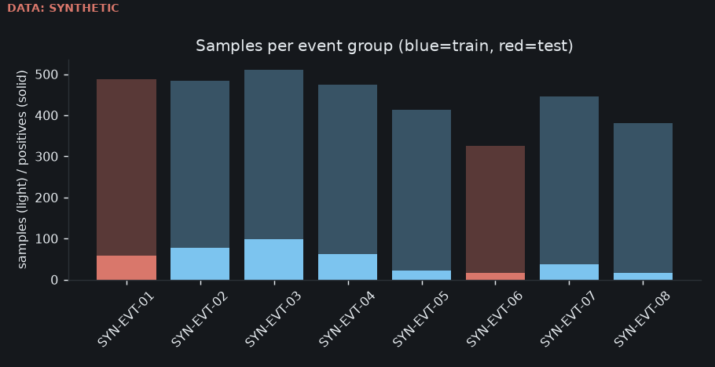

# TerraPulse training report - forecast mode

> **WARNING - SYNTHETIC DATA.** These numbers describe a model trained on fabricated data. They validate the software pipeline only and say nothing about the 2024 Thame GLOF.

**Mode:** SUSCEPTIBILITY / FORECASTING-STYLE: uses only pre-event conditioning factors (terrain, antecedent rainfall, soil moisture, vegetation, land cover, geology). No post-event SAR. Note: rainfall windows are assumed to end before the event.

- Data: `terrapulse_synthetic_v1.csv` (provenance: SYNTHETIC)
- Trained: 2026-11-14T06:57:05+00:00
- Split: pre-assigned train_test_group - train groups ['SYN-EVT-02', 'SYN-EVT-03', 'SYN-EVT-04', 'SYN-EVT-05', 'SYN-EVT-07', 'SYN-EVT-08'], test groups ['SYN-EVT-01', 'SYN-EVT-06']
- n_train=2707 (pos rate 0.116), n_test=812 (pos rate 0.091)
- Decision threshold: 0.290 (out-of-fold training predictions (max F1))

## Held-out test groups

| metric | @0.5 | @tuned | no-skill |
|---|---|---|---|
| precision | 0.440 | 0.252 | |
| recall | 0.149 | 0.365 | |
| F1 | 0.222 | 0.298 | |
| PR-AUC | 0.272 | | 0.091 |
| ROC-AUC | 0.718 | | 0.500 |
| Brier | 0.085 | | |

Confusion matrix @tuned: TN=658 FP=80 FN=47 TP=27

## Grouped CV on training groups (mean +/- std, threshold 0.5)

| metric | mean | std |
|---|---|---|
| precision | 0.341 | 0.289 |
| recall | 0.125 | 0.121 |
| f1 | 0.171 | 0.156 |
| pr_auc | 0.273 | 0.149 |
| roc_auc | 0.663 | 0.095 |

## Top features (impurity)

1. `rainfall_3d_mm` - 0.1169
2. `rainfall_7d_mm` - 0.0993
3. `rainfall_1d_mm` - 0.0904
4. `soil_moisture` - 0.0835
5. `rainfall_30d_mm` - 0.0751
6. `slope_deg` - 0.0689
7. `distance_to_river_m` - 0.0634
8. `ndvi` - 0.0604
9. `twi` - 0.0584
10. `curvature` - 0.0568
11. `elevation_m` - 0.0564
12. `distance_to_road_m` - 0.0543

## Top features (permutation, held-out PR-AUC drop)

1. `rainfall_3d_mm` - 0.0705 +/- 0.0257
2. `rainfall_7d_mm` - 0.0469 +/- 0.0218
3. `slope_deg` - 0.0289 +/- 0.0059
4. `rainfall_30d_mm` - 0.0213 +/- 0.0160
5. `rainfall_1d_mm` - 0.0191 +/- 0.0124
6. `geology` - 0.0131 +/- 0.0057
7. `twi` - 0.0089 +/- 0.0059
8. `distance_to_river_m` - 0.0066 +/- 0.0036
9. `elevation_m` - 0.0044 +/- 0.0068
10. `ndvi` - 0.0036 +/- 0.0096
11. `distance_to_road_m` - 0.0035 +/- 0.0045
12. `curvature` - 0.0024 +/- 0.0040

## Features

- numeric: elevation_m, slope_deg, aspect_deg, curvature, twi, distance_to_river_m, distance_to_road_m, rainfall_1d_mm, rainfall_3d_mm, rainfall_7d_mm, rainfall_30d_mm, soil_moisture, ndvi
- categorical: land_cover, geology
- excluded by leakage rules: acquisition_date, landslide_label, landslide_severity, landslide_area_m2, landslide_displacement_m, change_classification, sample_id, event_id, latitude, longitude, event_date, satellite_mission, product_type, inventory_source, label_confidence, data_quality_flag, train_test_group

## Plots

